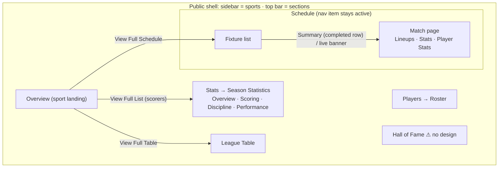
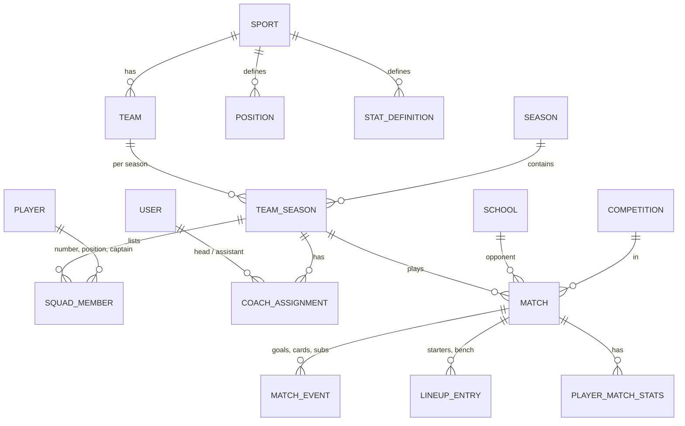

# 00 — Design Inventory

**Status:** Approved 2026-10-13 (open questions accepted with their defaults) · **Phase:** 0 · **Source:** `designs/stitch_sports_iq_analytics_platform/` (36 mockups, 26 images, 2 DESIGN.md)

## Decisions (2026-10-13)

| # | Decision | Replaces |
|---|---|---|
| 1 | The match page (Lineups · Stats · Player Stats) lives **under Schedule**. You reach it from a fixture row and the top nav highlights Schedule. The "Stats" nav item is Season Statistics only. 4 of the 13 match mockups already highlight Schedule | Q27 |
| 2 | Season Statistics is one page with 4 tabs, built from the 8 variants as in §1.1 | — |
| 3 | Colours, spacing and radius come from `turi_heritage_performance`. **Headings use Poppins**: everything DESIGN.md sets in Source Serif 4 (titles, large stat numbers, quotes). **Body and labels use Montserrat** | Q1 |
| 4 | An admin enters score-only results between other schools (D15). The league table is computed from all results | Q7 |
| 5 | Seed data uses fictional, generic names in every sport. Initials avatars wherever there's no photo. The local portraits are still used for basketball and netball | Q22 |
| 6 | Stat lists and match events per sport as proposed in Q9 and Q10 | Q9, Q10 |
| 7 | The dashboard adds Sports setup (D3, in the Season setup slice), Sport page content (D4) and Other league results (D15) | Q26 |
| 8 | My account is an avatar menu in the top-right corner (Google style), not a sidebar screen. See D17 | — |

## Key findings

- There are **6 public pages**, not 7. The 4 "player statistics" mockups are the **Player Stats tab of the match page**: they have the same scoreboard and the same `Lineups · Stats · Player Stats` tabs. The match page sits under Schedule (Decision 1).
- **Season Statistics is one page with 4 tabs** (Overview · Scoring · Discipline · Performance). Each of the 8 variants shows a different tab.
- **32 of 36 mockups were built with `turi_heritage` tokens** (maroon primary, Inter labels, Source Serif body text). Most of them hard-code navy `#002147` and gold `#E9C176` on top, so the screens *look* like `turi_heritage_performance`. Only the 4 overview pages use the performance tokens directly.
- **The league table needs results from matches Turi doesn't play in** (for example, Peponi vs Brookhouse). Nothing in the brief stores those. Decided: Decision 4.
- **No usable images for football or boys.** The only local photos are 22 female basketball and netball players and 3 coaches. Every image in the mockups is hot-linked from `lh3.googleusercontent.com`. Three mockups use baked-in lineup graphics with the names and faces of real professional footballers. **Never use those.**
- **Basketball and netball are mostly placeholder.** Their mockups reuse the football 3–1 score and the goal-minute scorers. They have no player-stat or season-stat designs.

---

## 1. Page map

### 1.1 Pages and chosen versions

| Page | Mockups | Follow | Borrow from others |
|---|---|---|---|
| **Global shell** | all | `football_league_table_updated_navigation`: full-height navy 256px sidebar (crest, school name, sports with icons) and a navy top bar with section links (gold underline on the active one) | Mobile menu button (same file). Footer from `match_statistics_brand_aligned_summary_4`. **Fix to DESIGN.md:** top bar 64px (mockups use 80px), active sidebar item gets a 4px gold left border (mockups use a filled pill) |
| **Sport Overview** | 4 | `basketball_overview_expanded_benefits_section` | Football fact set and copy from `football_overview_…_1/_2`. Netball facts from `netball_overview_comprehensive_guide`. Drop the overview-only sidebar (sections + "Sport Selector"); use the global shell |
| **Schedule** | 3 | `football_schedule_turi_branded_1` | `_2`/`_3` are the same layout for basketball and netball. Borrow only the sport icon in the live banner. Restyle the sidebar to the global shell |
| **Roster** ("Players") | 6 | `first_xi_roster_updated_brand_header_1` | Netball position names from `first_xi_roster_netball_transition`. "SQUAD" eyebrow from `_header_2`. `_header_3` is a **byte-identical duplicate** of `_1` |
| **Schedule › Match page**: Stats tab (default) | 9 | `match_statistics_brand_aligned_summary_4`: eyebrow + title, scoreboard card with HOME/AWAY pills and date, navy tab bar, comparison bars with an icon per stat, report quote | Export PDF / Share Report buttons and scorers-with-minutes from `match_statistics_first_xi_football_4`. Basketball and netball stat labels from `_summary_2` / `_summary_3`. Opponent initials badge ("NC") from `match_statistics_summary_view` |
| Schedule › Match page: Lineups tab | (same 9) | `match_statistics_first_xi_football_4`: **data-driven pitch** (players placed by x/y %), formation badge, Bench & Staff (subs with minute, coaching staff) | Depth chart: basketball (position → backup) from `_football_2`, netball (starter + 3 subs) from `_football_3`. Don't use the baked lineup images in `_1`/`_2`/`_3` |
| Schedule › Match page: Player Stats tab | 4 | `player_statistics_first_xi_football_2`: Top Performers (3 cards × 2 stats) + Full Squad table | Search box, ★ top performer, (C) captain and shirt numbers from `match_statistics_first_xi_football_4` |
| **League Table** | 2 | `football_league_table_updated_navigation` | none (`_st._andrew_s_turi` is the same table with no sidebar and an oversized nav) |
| **Season Statistics**: Overview tab | 8 | `season_statistics_sports_iq_1`: tab bar, working Team Form chart, 3 top-3 leaderboards | KPI cards (win rate + trend, goals, clean sheets, possession) from `season_statistics_sports_iq_2` |
| Season Stats: Scoring tab | (same 8) | `season_statistics_enhanced_turi_navy_1`: top-10 scorers and assists with appearances (P) | Coloured initials avatars from `scoring_statistics_first_xi_football` |
| Season Stats: Discipline tab | | `season_statistics_enhanced_turi_navy_2`: yellow and red card tables | — |
| Season Stats: Performance tab | | `season_statistics_performance_summary_table`: match records (Scoring Peak, Defensive Struggle, Dominant Win) | Season quote block (all variants) |

Variants not chosen, and why:

| Mockup | Why not chosen |
|---|---|
| `match_statistics_first_xi_football_1/2/3` | Baked lineup images (real pro players' names in `_1`). Netball badge says "4-3-3 Attacking" |
| `match_statistics_brand_aligned_summary_1/2/3` | Same as `_4` but with a placeholder crest, the same icon on every stat, "Stats" twice in the nav, and netball "Total Shots" listed twice with the value "T3" |
| `match_statistics_summary_view` | Only 5 stats. Uses a different crest |
| `player_statistics_first_xi_football_1/3` | Sidebar shows "Hockey" with the rugby icon and no Rugby item. `_1` has a 10-column table (G A GP SOG CLR GA SV SHOT) |
| `player_statistics_immersive_background` | Photo background makes the title and quote unreadable |
| `first_xi_roster_basketball_transition` | Abbreviated names ("Zahara K."), otherwise identical |
| `first_xi_roster_basketball_active_refined_analytics` | Shows football despite the folder name |
| `season_statistics_brand_aligned_navigation`, `_comprehensive_view` | Earlier Overview tab with an "Interactive Chart Component Loading…" placeholder |
| `season_statistics_enhanced_turi_navy_1/2`, `_performance_summary_table`, `scoring_statistics_…` | Screenshots show a black page because `<body>` sets no background. That's a rendering bug, not design intent: use the light surface |

### 1.2 Public site map

### 1.3 Design systems compared

| Token | `turi_heritage_performance` (default) | `turi_heritage` | What the mockups actually render |
|---|---|---|---|
| Primary | Turi Navy `#002147` | Turi Maroon `#800000` | Navy chrome, maroon primary buttons (e.g. Share Report) |
| Accent gold | `#C5A059` | `#D4AF37` | `#E9C176`, `#EAB308` and `#D4AF37` all appear |
| Secondary | Turi Red `#800020` | Royal Navy `#335390` | `#335390` for page titles and blue headers |
| Headings | Source Serif 4 | Source Serif 4 | Source Serif 4 → **we use Poppins** (Decision 3) |
| Body / labels | Montserrat | Source Serif 4 / Inter | Source Serif + Inter (32 mockups), Montserrat (4) → **we use Montserrat** |
| Radius | 4px default, `full` = circle | same | Tailwind config overrides: 2px default, `full` = **12px**, so "round" avatars render as rounded squares |
| Page margins | 64px / 16px | 80px / 20px | 80px / 20px in most |
| Top bar | 64px | — | 80px (`h-20`) in most |

### 1.4 Image assets (seed)

| Folders | Count | Content | Seed use |
|---|---|---|---|
| `…female_student_athlete_black_african_descent_1…17` | 17 | Girls in numbered St. Andrew's basketball jerseys | Basketball girls squad |
| `…female_student_athlete_black_african_descent_east_1…5` | 5 | Girls in netball position bibs | Netball squad (7 starters, so initials avatars fill the rest) |
| `…male_basketball_head_coach…` | 1 | Male coach | Basketball head coach |
| `…female_basketball_assistant_coach…` | 1 | Female coach | Basketball assistant coach |
| `…female_netball_head_coach…` | 1 | Female coach | Netball head coach |
| `a_professional_sports_broadcast_lineup_graphic…` | 1 | Baked "Starting Five" graphic | Not data. Don't use as a lineup |
| *missing* | — | Football players, boys, Turi crest, opponent crests, hero/action/history/gallery photos | Initials avatars and placeholders until you supply them. All seed names are fictional (Decision 5) |

Jersey mascots also differ between photos ("Stars", "Saints", "Wildcats").

---

## 2. Data inventory

S = stored, D = derived (computed, not stored). "Edit" is the dashboard screen from §4.

### 2.1 Entities seen in the UI (not the schema; that's Phase 2)

### 2.2 Fields

**School** (Turi and opponents)

| Field | Example | Shown on | S/D | Edit |
|---|---|---|---|---|
| name, short name | St. Andrew's Turi · Peponi School · "Brookhouse" | all | S | D8, D18 |
| crest / logo (initials fallback) | phoenix crest · "NC" | match, schedule, league, overview | S | D8, D18 |
| tagline, footer line | Excellence & Character · "Excellence in the Highlands" | shell, footer | S | D18 |

**Sport**

| Field | Example | Shown on | S/D | Edit |
|---|---|---|---|---|
| name, icon | Football · `sports_soccer` | sidebar, titles | S | D3 |
| positions (name, abbreviation) | Forward/FW · Goal Shooter/GS | roster, match, depth chart | S | D3 |
| team stat definitions (label, icon) | Possession, Corners | match Stats tab | S | D3 |
| player stat definitions (label, abbreviation) | Goals/G, Tackles/Tkl | Player Stats tab, leaderboards | S | D3 |
| lineup format | 11 + formation "4-3-3 Attacking" · 5 · 7 | Lineups tab | S | D3 |
| standings points | 3/1/0 | league table | S | D3 |
| scoring unit | Goals · Points | overview top scorers | S | D3 |
| overview content | hero (eyebrow, title, text, image), history (image, text), facts (icon, label, text) ×6–7, Turi Approach (2 texts), Core Benefits (icon, title, text) ×6, Training Tips (thumbnail, title, duration, category, video URL) ×3, Learning Pathways (title, text, playlist URL) ×3 | Overview | S | D4 |

**Season**

| Field | Example | Shown on | S/D | Edit |
|---|---|---|---|---|
| label | 2023/2024 | filters, titles | S | D5 |
| start/end dates, current flag | — (needed to bucket fixtures) | default filters | S | D5 |

**Team / Team-season**

| Field | Example | Shown on | S/D | Edit |
|---|---|---|---|---|
| sport, name, age group, gender, order | First XI · Second XI · U16 · U19 Boys · U15 Girls | roster tabs, filters, titles | S | D6 |
| head and assistant coach | Mr. J. Smith · Coach Sarah Jones (photo, role) | roster, match staff | S | D10 |
| members: player, shirt number, position | #10 Forward | roster, match | S | D12 |
| captain | Amina J. Okafor | roster card, "(C)" in match | S | D12 |
| depth chart (basketball, netball) | PG → S. Omondi (#12) | Lineups tab | S | D12 (Q12) |
| season quote + attribution | "Discipline, teamwork…" — Director of Athletics | season stats | S | D6 |

**Player**

| Field | Example | Shown on | S/D | Edit |
|---|---|---|---|---|
| full name, short form | Zahara Kamau · "Zahara K." · "O. Kariuki" | everywhere | S (short form D) | D11 |
| photo (initials fallback "KIP") | — | roster, tables, top performers | S | D11 |
| gender | — | gender split, "Girl Players" | S | D11 |

**User / staff**

| Field | Example | Shown on | S/D | Edit |
|---|---|---|---|---|
| display name with title, photo | Mr. D. Ochieng | roster, Bench & Staff | S | D9, D17 |
| email, password, role, status | — (not shown) | — | S | D9 |

**Competition**

| Field | Example | Shown on | S/D | Edit |
|---|---|---|---|---|
| name | KAISSO · IAPS · Friendlies · Kenya International Schools League · Premier Division · Rift Valley Regional Final | schedule, match header, league | S | D7 |
| type, counts toward standings | league / cup / friendly | league table | S | D7 |

**Match** (fixture + result)

| Field | Example | Shown on | S/D | Edit |
|---|---|---|---|---|
| team, opponent, home/away | U19 Boys 1st XI vs Peponi · H/A pills | schedule, match | S | D13 |
| date & time (shown in EAT) | Sat, 28 Oct · 15:00 EAT | schedule, match, overview | S | D13 |
| venue | Turi Main Pitch · Brookhouse · Tech Stadium | schedule | S | D13 |
| competition + round | "Rift Valley Regional Final" | match subtitle, schedule | S | D13 |
| status | Upcoming · Live · Full Time | schedule, live banner, match | S | D13, D14 |
| score | 3–1 | schedule, banner, match | S | D14 |
| Turi goals: scorer, minute | O. Kariuki 14', 68' | scoreboard | S | D14 |
| opponent scorers (free text) | D. Patel 81' | scoreboard | S | D14 |
| cards: player, colour, minute | — | discipline, team stats | S | D14 |
| subs: player on, (off), minute | S. Omondi ⇄ 65' | Bench & Staff | S | D14 |
| formation, starters (number, slot), bench | 4-3-3 · 5 Ochieng (C) | Lineups tab | S | D14 |
| coaching staff at match | Mr. J. Smith, Head Coach | Bench & Staff | D (from D10) | D10 |
| team stats, both sides | Possession 55/45, Shots 14/8 | Stats tab, KPIs, form chart | S | D14 |
| player stats | Min 90', G 2, A 0, SOT 3 | Player Stats tab, leaderboards | S | D14 |
| top performers, ★ | 3 cards · star on O. Kariuki | Player Stats tab | S (Q13) | D14 |
| report quote + attribution | "A resolute display…" — Director of Sport | match | S | D14 |
| hero photo, gallery photos | action background · "Recent Match Gallery" | match, roster | S | D14 |
| published flag | — | gates public reads | S | D14 |

**Other league results** (Decision 4) · **Hall of Fame** (no design, Q17): D15, D16.

### 2.3 Derived data

| Data | Shown on |
|---|---|
| Standings: P W D L GF GA GD Pts, form (last 5), champion row | League Table, Overview widget (top 4) |
| KPIs: win rate + change vs last season, total goals, clean sheets, average possession | Season Overview |
| Team form: possession % and goal difference per match, last 10 | Season Overview chart |
| Leaderboards with appearances (P): goals, assists, defensive (clearances/saves/tackles), yellow, red | Season tabs, Overview "Top Scorers" |
| Records: Scoring Peak, Defensive Struggle, Dominant Win (value, match, date) | Season Performance tab |
| Roster analytics: player count, gender split (% + count), new vs returning vs last season, girl players, academy distribution (% of the sport's players per team) | Roster |
| Upcoming matches (next 3–4 across the sport's teams), live banner | Overview, Schedule |

### 2.4 Differences by sport

| | Football | Basketball | Netball |
|---|---|---|---|
| On court/pitch | 11 | 5 | 7 |
| Format | 2 × 45 min | 4 × 10 min | 4 × 15 min |
| Positions | Goalkeeper, Defender (Center Back, Fullback), Midfielder, Forward | Guard, Forward, Center · PG, SG, SF, PF, C | GS, GA, WA, C, WD, GD, GK |
| Lineup view | Pitch + formation | Starting Five + depth chart (1 backup) | Starting Seven + depth chart (3 subs) |
| Team match stats | Possession, Shots, On target, Corners, Fouls, Yellow, Red, Offsides, Saves | Rebounds, Turnovers, Fouls, Steals, 3-pointers, Layups, Free-throw %, Assists | Shooting %, Centre-pass conversion, Rebounds, Turnovers won, Shots, Contact penalties, Obstruction penalties |
| Player match stats (as designed) | Min, Goals, Assists, Shots, On target, Clearances, Saves, Tackles, Pass %, Goals against, Distance | none designed | none designed |
| **Player match stats (agreed, Decision 6)** | Min, Goals, Assists, Shots, On target, Tackles, Clearances, Saves, Goals conceded. Pass % and Distance dropped | Min, Points, Rebounds, Assists, Steals, Blocks, Turnovers, Fouls, 3PM, FTM/FTA | Goals, Attempts, Shooting %, Intercepts, Deflections, Rebounds, Turnovers, Penalties |
| Scoring | Goals | Points (1/2/3) | Goals (GS/GA only) |
| Standings | P W D L GF GA GD Pts, form | Pts only (overview widget) | Pts only (overview widget) |
| Match events (as designed) | Goals, cards, subs with minutes | Football placeholder copied | Football placeholder copied |
| **Match events (agreed, Decision 6)** | Goals (minute, assist), cards, subs (on, off, minute) | Score by quarter. Scoreboard shows top scorers instead of minutes | Score by quarter. Scoreboard shows top scorers instead of minutes |

---

## 3. Actions

| Action | Where | Proposal for v1 |
|---|---|---|
| Switch sport | Sidebar, all pages | Keep. Sport in URL |
| Switch section (Overview, Schedule, Players, Stats/Statistics, League Table, Hall of Fame) | Top bar | Keep. Label it "Stats" |
| Filter by team | Schedule ("All Teams"), League (select), Roster (First XI / Second XI / U16 tabs) | Keep. In URL |
| Filter by season | League (select) | Keep. **Also add to Roster and Season Stats** (no selector designed there) |
| Filter by month | Schedule ("All Months") | Keep |
| Upcoming / Completed tabs | Schedule | Keep |
| Summary (completed row), click live banner | Schedule | Open match page |
| Lineups / Stats / Player Stats tabs | Match page | Keep. In URL |
| Overview / Scoring / Discipline / Performance tabs | Season Stats | Keep. In URL |
| Export PDF, Share Report | Match page | Keep (how: Phase 1) |
| Search player | Player Stats table | Keep (client-side filter) |
| View Full Squad (expand) | Roster | Keep |
| View Full Schedule / Full List / Full Table | Overview widgets | Link to Schedule / Season Stats Scoring / League |
| Play training video, View Playlist ×3, View All Drills | Overview | External links (admin-entered URLs) |
| Chart hover | Season Overview | Keep (tooltips) |
| Mobile menu, sidebar collapse | Few mockups | Keep as a mobile drawer |
| Global search (athletes, teams) | Schedule, Roster, League, Season | Q19 |
| Live Scores button | Overview, Season (`sports_iq_2`) | Q18 |
| Notifications, Settings gear | Most top bars | Q19 (default: drop) |
| Profile / avatar | Most top bars | Account avatar menu top-right (Decision 8) |
| Help, Support, Archive, Logout, Add Team, New Season, View All Sports/Disciplines, Sport Selector | Sidebars | Q19 (default: drop from public; admin actions live in the dashboard) |
| Footer links (Privacy Policy, Athletic Standards, Contact Coach, Terms, Support, API Documentation, Contact Athletics Dept, Turi Portal) | Footers | Q20 |
| Click player, gallery photo, coach card | Roster, tables | Nothing designed (Q24) |

---

## 4. Dashboard screens

Every stored field in §2.2 is edited on one of these. Coaches see the same screens filtered to their assigned teams.

| # | Screen | Who | Edits | Feeds |
|---|---|---|---|---|
| D1 | Login | both | session | — |
| D2 | Home | both | nothing. Shortcuts: my teams, fixtures waiting for results, drafts | — |
| D3 | Sports | admin | name, icon, positions, team and player stat definitions, lineup format, standings points | every public page |
| D4 | Sport page content | admin | overview content blocks | Overview |
| D5 | Seasons | admin | label, dates, current | all filters |
| D6 | Teams | admin | sport, name, age group, gender, order. Per season: season quote | Roster tabs, filters, titles, Season Stats quote |
| D7 | Competitions | admin | name, type, counts toward standings | Schedule, match header, League |
| D8 | Opponent schools | admin | name, short name, logo | Schedule, match, League |
| D9 | Users | admin | name/title, email, role, active, temp password, photo | Roster staff, match staff |
| D10 | Coach assignments | admin | user ↔ team-season, role (head/assistant) | Roster staff, match staff, permissions |
| D11 | Players | both | name, photo, gender | everywhere |
| D12 | Roster | both | squad members, number, position, captain, depth chart | Roster, match, stats |
| D13 | Fixtures | both | team, opponent, home/away, date/time, venue, competition, round, status | Schedule, Overview upcoming, live banner |
| D14 | **Match result entry** | both | score, status, events, formation + lineup + bench, team and player stats, top performers, report quote, photos, publish | Match page, Schedule, League, Season Stats, Roster gallery, Overview widgets |
| D15 | Other league results | admin | score-only results between other schools | League Table, Overview standings (Decision 4) |
| D16 | Hall of Fame | admin | TBD | Hall of Fame (Q17) |
| D17 | My account: **avatar menu, top-right** (Google style) | both | own name, photo, password | staff cards |
| D18 | School settings *(proposed to drop, see Q29)* | admin | Turi name, crest, tagline, footer line | shell, match, League |

**D17, avatar menu (Decision 8).** Same top-right spot on the dashboard and on the public site.
- Signed in: a circular photo or initials. Clicking it opens a popover with the photo, name, email, a role badge (Admin / Coach), and links to *Manage your account* (name, photo, password), *Dashboard* or *View public site* (whichever you're not on), and *Sign out*.
- Signed out (public site): a small "Staff sign in" button in the same spot.

Slice order (Decision 7): D3 joins "Season setup", D17 joins "Auth and dashboard shell", D4 and D15 come after Hall of Fame.

---

## 5. Gaps and inconsistencies

### 5.1 Navigation items with no design

| Item | Appears in | Proposal |
|---|---|---|
| Hall of Fame | Top bar, every page | Needs content definition and a wireframe (Q17) |
| Profile | Roster top bar, avatar on most pages | Public has no accounts. Drop it; dashboard gets "My account" (D17) |
| Settings | Gear on most pages, Roster sidebar | Drop from public |
| Live Scores | Overview button, schedule "Live Match Banner" | Q18 |
| Search, notifications | Most top bars | Q19 |
| Player profile page | Implied by player cards and names | Not designed. No links in v1 (Q24) |
| "Dashboard / Teams / Fixtures / Alumni" nav | `season_statistics_sports_iq_2` only | Stray. Ignore |

### 5.2 No login or dashboard designs
Covered by §4. Dashboard screens reuse the public primitives. I'll wireframe each one before building it (Phase 4).

### 5.3 The sports list differs between screens

| Sports in sidebar | Mockups |
|---|---|
| Football, Basketball, Rugby, Hockey, Cricket (**no Netball**) | most |
| Netball replaces Football | `first_xi_roster_netball_transition`, `match_statistics_first_xi_football_3` |
| 12 sports: + Netball, Swimming, Athletics, Tennis, Golf, Squash, Equestrianism | schedules |
| + Swimming | `season_statistics_sports_iq_1` |
| Overview, Rugby, Hockey, Cricket, Swimming | `season_statistics_sports_iq_2` |
| Football, Basketball, Netball | `football_overview_…_2` |
| "Hockey" with the rugby icon, no Rugby | `player_statistics_first_xi_football_1/3` |

Proposal: the sidebar lists sports from the database (Q8).

### 5.4 Stats and positions differ by sport
See §2.4. Basketball and netball have no player-stat, season-stat or event designs (agreed lists: Decision 6). "First XI" is used for basketball and netball teams too (Q15).

### 5.5 Other inconsistencies

| Area | Issue |
|---|---|
| Tokens | Two token sets, 4 golds, 3 navies, radius and top-bar height differ from DESIGN.md (§1.3) |
| Brand | Product name varies: Sports IQ · St. Andrew's Turi Sports · Turi Sports · Turi Athletics · St. Andrew's Turi Athletics · S.A.T. Tagline varies: Excellence & Character · Excellence in Sport · Elite Athletics · Elite Performance |
| Crest | Phoenix "Altiora Peto" crest in most mockups. A different saltire crest in `match_statistics_summary_view` and `season_statistics_sports_iq_2`. Grey "img" placeholders in some |
| Information architecture | Overview pages use the sidebar for sections plus a "Sport Selector"; every other page uses the sidebar for sports. League Table is missing from some top bars |
| Placeholder data | Basketball and netball matches show 3–1 with goal minutes. Netball stats list "Total Shots" twice with the value "T3". "Coversion" typo. Schedule team filter offers "FC Analytics / Data United". Yellow-card table lists "Brian N." twice. Overview standings show a team called "International School" |
| Overview copy | Football and netball pages say "We teach basketball…" and "elite court performance". Netball reuses basketball's "Core Benefits" (sneakers, rim). YouTube links point to unrelated channels |
| Roster facts | "First XI Football" shows 11 female and 6 male players with all-female photos, while the match page says "U19 Boys 1st XI". "Girl Players 24" conflicts with the 17-player count |
| Seasons and dates | 2023/2024 (league, season stats), "2024" (schedule), 2026/2027 (roster). Matches dated Oct 2024 |
| Schedule rows | No column shows which Turi team plays, so "All Teams" is ambiguous. Add a team label |
| Admin controls in public chrome | Add Team, New Season, Logout, "Administrator Profile" avatar |
| Mobile | Sidebar is `hidden md:flex` in all mockups. Only 3 show a menu button. Needs a drawer |
| Substitutions | Only the player coming on and the minute are shown, not who went off |
| Hard-to-collect stats | Distance (10.2 km) and Pass accuracy (92%) need tracking equipment |
| "Defensive Pillars" | Ranks clearances, saves and tackles together in one list |
| Images | All 351 mockup images are hot-linked (unknown licence, may expire). Baked lineup images include real professional players' names and likenesses |
| League data | Standings need results of matches between other schools (Decision 4) |

---

## 6. Questions for you

Each one has a default. Reply "defaults OK" or list the numbers you want to change. Already decided: Q1, Q7, Q9, Q10, Q22, Q26, Q27 (see Decisions).

### A. From the kickoff

| # | Question | Default |
|---|---|---|
| Q2 | Turi only, or several schools? | Turi only. Opponents are School records with no users |
| Q3 | JavaScript or TypeScript? | JavaScript with ES modules |
| Q4 | How do coaches get accounts? | An admin creates them with a temporary password. No self sign-up. Force a password change at first login? Default: yes |
| Q5 | Password reset by email in v1? | No. An admin resets passwords |
| Q6 | Results live on save, or draft until published? | Draft, then the coach publishes. Before publishing, the fixture's status and score can still show publicly so the "Live" banner works. Events, lineup and stats stay hidden |

### B. Blocking Phase 1 and 2

| # | Question | Default |
|---|---|---|
| Q8 | Which sports are in v1? | Football, basketball, netball fully defined. Rugby, hockey, cricket in the nav with a "coming soon" state. Drop the other 6 sports from the schedule mockup |
| Q11 | Standings points per sport? | Set per sport. Football 3/1/0. Basketball 2 per win, 1 per loss. Netball 2/1/0. Please confirm with KAISSO rules |
| Q12 | Is the depth chart per match or per team-season? | Per team-season (edited in Roster), shown on the match Lineups tab |
| Q13 | Who picks the Top Performers and the ★? | The coach picks up to 3 in result entry. Each card shows that player's two headline stats for their position |
| Q14 | Are teams single-gender? | Each team has a gender (Boys / Girls / Mixed). The gender split is computed from player records |
| Q15 | Team names for basketball and netball? | Free text per team (for example "First V", "First VII") |
| Q16 | What is a season? | An admin sets start and end dates. Label "YYYY/YYYY" (academic year) |
| Q29 | Keep a separate School settings screen (D18)? | **No.** Rename D8 to "Schools" and list Turi there alongside opponents, edited the same way (name, short name, crest). Turi has to be a School anyway because it appears in league tables. The tagline, footer line and footer links are fixed in the client config: they change maybe once in several years |

### C. Can wait until the slice is built

| # | Question | Default |
|---|---|---|
| Q17 | What's in the Hall of Fame? | Inductee cards (name, photo, sport, years, achievement, citation), managed by admins. Wireframe before building |
| Q18 | Live scores? | No real-time updates. The coach sets status to Live and updates the score; the Schedule banner shows it on page load. Drop the "Live Scores" button |
| Q19 | Search, notifications, settings, help, archive, Add Team, New Season in the public chrome? | Drop them all. The top-right spot holds the account avatar or "Staff sign in" (Decision 8) |
| Q20 | Footer links? | "Contact Athletics Dept" (mailto) and "Privacy Policy" (link to the school site; please give me the URLs). Drop the rest |
| Q21 | Brand name and crest? | Sidebar: crest + "St. Andrew's Turi" + "Excellence & Character". Browser title "Sports IQ · St. Andrew's Turi". Phoenix crest. Please send the official crest file |
| Q23 | Sport overview copy? | Admins can edit it. Seed with corrected copy. Should the humorous "Core Benefits" tone stay? |
| Q24 | Player profile page? | Not in v1. Player names aren't links |
| Q25 | How are the season records defined? | Scoring Peak = most goals Turi scored in a match. Dominant Win = largest winning margin. Defensive Struggle = most goals Turi conceded in a match |
| Q28 | Roster "Academy Player Distribution": a share of which players? | Each team's share of all players in the selected sport and season |
