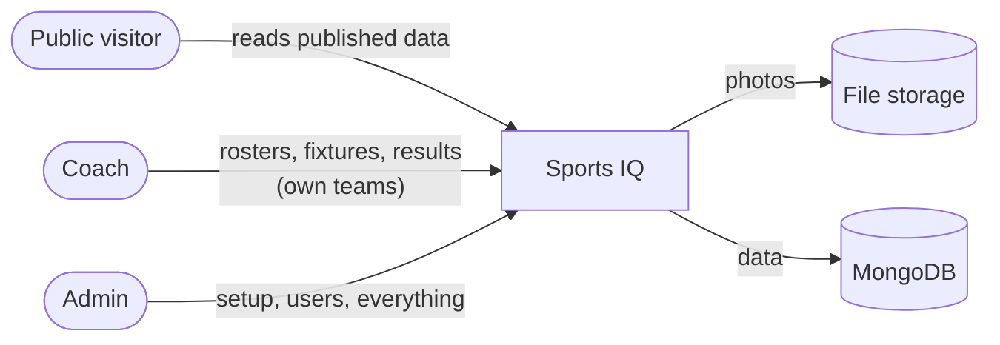
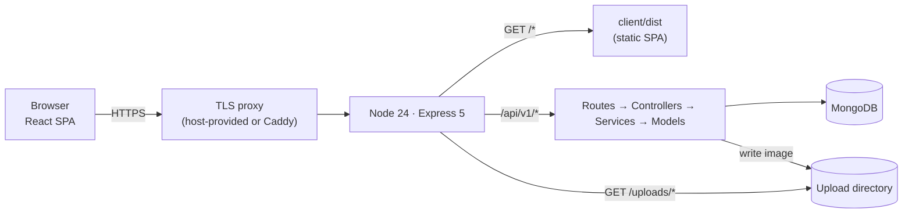
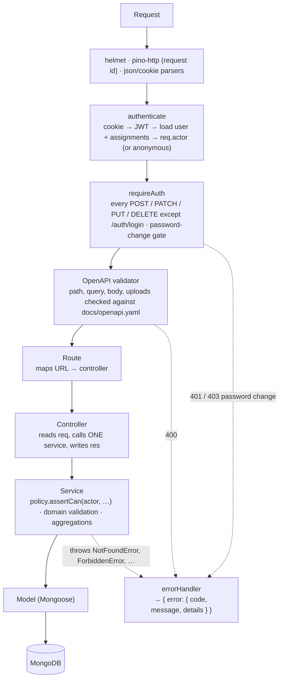
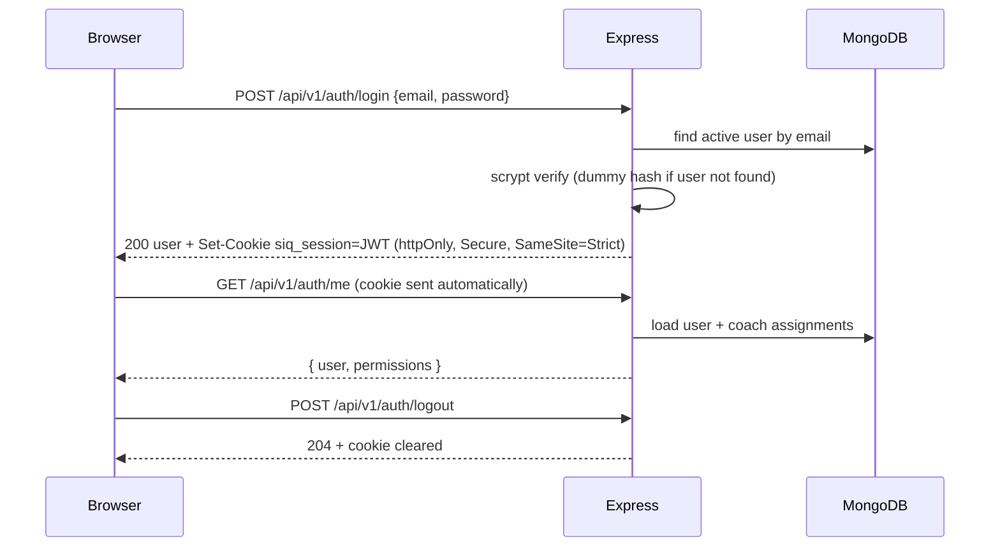
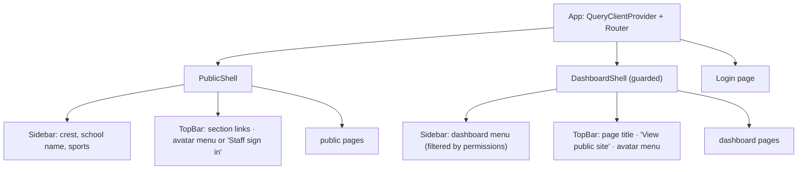

# 01 — System Design & Architecture

**Status:** Approved 2026-10-14 (P1-Q1…Q4 accepted with their defaults) · **Phase:** 1 · **Builds on:** [00-design-inventory.md](00-design-inventory.md) (approved 2026-10-13)

Inputs from Phase 0 that shape this doc: Turi only (Q2) · JavaScript with ES modules (Q3) · admin-created accounts with a forced password change (Q4) · no email reset (Q5) · draft → publish (Q6) · match page under Schedule (Decision 1) · Poppins + Montserrat (Decision 3) · avatar menu top-right (Decision 8) · no School settings screen (Q29) · no real-time updates (Q18).

---

## 1. Context

### 1.1 Users

| User | Main use cases | Reads | Writes |
|---|---|---|---|
| **Public visitor** (parents, students, alumni, other schools) | Check fixtures, see results and match stats, browse squads, follow standings and leaderboards, print or share a match report | Published data only | Nothing |
| **Coach** | Keep the roster current, add fixtures, enter and publish a result after each match (often on a phone at the pitch) | All public data + drafts of their teams | Players, squads, fixtures and results of **their assigned team-seasons**; own account |
| **Admin** (e.g. Director of Sport) | Set up each season, manage sports and stat definitions, overview content, schools, competitions, coach accounts and assignments, other schools' league results, Hall of Fame | Everything, including drafts | Everything |



### 1.2 High-level architecture

One deployable: a Node.js process serves the API, the built React app and uploaded photos from **one origin** (ADR-03).



| Environment | How it runs |
|---|---|
| Development | Vite dev server on `:5173` proxies `/api` and `/uploads` to Express on `:3000`. One command: `npm run dev` |
| Test | Vitest + Supertest against the Express app with `mongodb-memory-server`. No network, no real DB |
| Production | `npm run build` then `npm start`. Express serves `client/dist`, `/api/v1` and `/uploads` |

---

## 2. Repo layout

npm workspaces monorepo (ADR-01).

```
sports-iq/
├── package.json          # workspaces: client, server · scripts: dev, build, start, test, lint, seed
├── .env.example          # server env vars + seed credentials (never in docs)
├── CLAUDE.md             # engineering rules (Phase 4, step 1)
├── eslint.config.js · .prettierrc
├── docs/                 # 00–03 + openapi.yaml (the API contract)
├── designs/              # Stitch export, read-only
├── server/
│   ├── src/
│   │   ├── app.js        # builds the Express app (imported by tests)
│   │   ├── server.js     # connects MongoDB, starts listening
│   │   ├── config.js     # the only module that reads process.env
│   │   ├── routes/       # URL → controller
│   │   ├── controllers/  # HTTP ↔ service translation
│   │   ├── services/     # business logic, policy calls, aggregation pipelines
│   │   ├── models/       # Mongoose schemas + shared plugins (audit)
│   │   ├── auth/         # policy.js, password.js, session.js
│   │   ├── middleware/   # authenticate, requireAuth, errorHandler
│   │   └── lib/          # errors.js (typed errors), logger.js
│   ├── scripts/seed.js
│   └── test/             # API + service tests, one file per resource
└── client/
    ├── index.html        # Google Fonts links (Poppins, Montserrat, Material Symbols)
    └── src/
        ├── main.jsx · App.jsx        # providers + route table
        ├── api/client.js             # the one API client
        ├── hooks/                    # data (TanStack Query) + behaviour (URL state, media query)
        ├── components/               # primitives + composites, each with its own .module.css
        ├── pages/public/ · pages/dashboard/
        ├── lib/                      # pure helpers: EAT date formatting, image resize, initials
        └── styles/tokens.css · global.css
```

`client/src/lib/` is the one folder the kickoff rules don't list. It holds pure functions that aren't hooks or components.

---

## 3. Backend

### 3.1 Request pipeline and layers



| Concern | Lives in | Notes |
|---|---|---|
| Authentication | `middleware/authenticate.js` (every request), `middleware/requireAuth.js` (every write, mounted once before validation) | Identity comes only from the cookie, never from the body or query. Mounting `requireAuth` once means a new write route can't forget it, and anonymous writes always get 401, never 400 |
| Authorization | `auth/policy.js`, called **only from services** | Services hold the loaded resource, so they can check its team. No role or team checks anywhere else |
| Shape validation | `express-openapi-validator` reading `docs/openapi.yaml` | Types, required fields, enums, ID patterns, upload size and type. Responses are validated too when `NODE_ENV=test` |
| Domain validation | Services | Stat keys exist for the sport, lineup size, player is in the squad, jersey numbers unique. Throws `ValidationError` |
| Persistence rules | Models | Mongoose validators, unique indexes (`E11000` → `ConflictError`), audit plugin (`updatedBy`, `updatedAt`), optimistic concurrency |
| Error handling | `middleware/errorHandler.js` | The only place that builds an error response. Express 5 forwards rejected promises, so no hand-written async wrapper is needed (ADR-04) |
| Stats | Services, as aggregation pipelines | No looping over documents in JavaScript |

### 3.2 Errors

Typed errors in `lib/errors.js`, all extending `AppError { status, code, details }`.

| Status | `code` | Thrown when |
|---|---|---|
| 400 | `VALIDATION_ERROR` | OpenAPI shape check or domain rule fails. `details: [{ path, message }]` |
| 401 | `UNAUTHENTICATED` | No session, expired or revoked session |
| 403 | `FORBIDDEN` | The policy says no |
| 403 | `PASSWORD_CHANGE_REQUIRED` | Account still has a temporary password (only `/auth/me`, `/auth/logout`, `/auth/password` are allowed) |
| 404 | `NOT_FOUND` | Resource missing, or a draft the caller may not see |
| 409 | `CONFLICT` | Duplicate (email, jersey number) or stale version on save |
| 413 / 415 | `PAYLOAD_TOO_LARGE` / `UNSUPPORTED_MEDIA_TYPE` | Upload over 2 MB, or not JPEG/PNG/WebP |
| 429 | `RATE_LIMITED` | Too many login attempts |
| 500 | `INTERNAL_ERROR` | Anything unexpected. Logged with the stack; the response never includes it |

Every response carries `X-Request-Id`, so a coach's error report can be matched to a log line. The success shape is defined in Phase 3.

---

## 4. Auth

### 4.1 Login and session



| Item | Decision |
|---|---|
| Session | JWT (HS256) in an httpOnly cookie `siq_session`. Payload: `{ sub: userId, tv: tokenVersion }`. Expires after **7 days** |
| Per request | `authenticate` verifies the JWT, then **loads the user and their assignments from MongoDB**. A disabled user, a changed role or a new assignment takes effect immediately |
| Revocation | Password change, admin reset or disabling a user increments `tokenVersion`. Every older cookie stops working |
| CSRF | `SameSite=Strict` + same-origin app + JSON request bodies. No CSRF token needed |
| Password hashing | `node:crypto` **scrypt** (N=2¹⁷, r=8, p=1, 16-byte random salt, 64-byte key), stored as `scrypt$N$r$p$salt$hash`, compared with `timingSafeEqual` (ADR-07) |
| Password rules | 10–128 characters, no composition rules (NIST 800-63B) |
| Brute force | `express-rate-limit` on `/auth/login`: 10 attempts per 15 min per IP + email. Always the same message: "Invalid email or password" |
| Accounts (Q4) | An admin creates the user with a temporary password → `mustChangePassword: true` → the user must set a new one before doing anything else |
| Reset (Q5) | An admin sets a new temporary password. No email |
| Endpoints | `POST /auth/login`, `POST /auth/logout`, `GET /auth/me`, plus **`POST /auth/password`** (change own password: needed for Q4 and My account) |

### 4.2 Authorization: one policy

`server/src/auth/policy.js` is the only place that knows the rules.

```js
can(actor, action, type, resource?)       // → boolean
assertCan(actor, action, type, resource?) // throws ForbiddenError
describe(actor)                           // → permissions object returned by /auth/me
```

| Resource type | Public read | Coach write | Admin write |
|---|---|---|---|
| sport, season, team, competition, school, user, assignment, league result, hall of fame | ✓ (users: never) | ✗ | ✓ |
| player | ✓ (public fields) | if the player is in a squad of one of their team-seasons, or is being added to one | ✓ |
| squad (roster) | ✓ | own team-seasons | ✓ |
| match: fixture | ✓ | own team-seasons. On a team change, both the old and the new team must be theirs | ✓ |
| match: result details (events, lineup, stats, report) | only when published | own team-seasons, including drafts | ✓ |
| upload | ✓ (files are public) | ✓ | ✓ |
| own account | — | ✓ | ✓ |

Rules:
- Admins can do everything. Coaches can write only to resources that resolve to a **team-season they're assigned to**.
- `actor` is always built server-side from the cookie. Role and team IDs sent by the client are ignored.
- Read visibility of drafts goes through the same policy (`can(actor, 'readDraft', 'match', m)`). Anonymous callers get the public projection.
- `describe(actor)` returns `{ screens: [...], teamSeasons: [...] }` so the client can show or hide menus and actions. The server still enforces every write.

---

## 5. Frontend

### 5.1 Public routes

Sport is in the path. Team, season, tab and filters are query parameters; defaults are left out of the URL. Slugs (`football`, `first-xi`, `2024-2025`) are defined in Phase 2.

| URL | Page | Query (default) | Follows |
|---|---|---|---|
| `/` | redirect to the first sport | — | — |
| `/:sport` | Sport Overview (or "coming soon" for rugby, hockey, cricket) | — | `basketball_overview_expanded_benefits_section` |
| `/:sport/schedule` | Schedule: fixture list | `team` (all), `season` (current), `month` (all), `view` (`upcoming` \| `completed`) | `football_schedule_turi_branded_1` |
| `/:sport/schedule/:matchId` | Match page (nav: Schedule) | `tab` (`stats` \| `lineups` \| `players`) | `match_statistics_brand_aligned_summary_4` + `_first_xi_football_4` + `player_statistics_first_xi_football_2` |
| `/:sport/players` | Roster | `team` (first team), `season` (current) | `first_xi_roster_updated_brand_header_1` |
| `/:sport/stats` | Season Statistics | `team`, `season`, `tab` (`overview` \| `scoring` \| `discipline` \| `performance`) | `season_statistics_sports_iq_1` + 4 tab variants |
| `/:sport/league-table` | League Table | `team`, `season` | `football_league_table_updated_navigation` |
| `/hall-of-fame` | Hall of Fame (wireframe first) | `sport` | none |
| `/login` | Staff sign in (wireframe first) | `next` | none |
| `*` | Not found | — | none |

### 5.2 Dashboard routes

None of these have designs: each gets a wireframe before it's built (Phase 4).

| URL | Screen | Who |
|---|---|---|
| `/dashboard` | D2 Home: my teams, fixtures waiting for a result, drafts | both |
| `/dashboard/account` | D17 My account (opened from the avatar menu) | both |
| `/dashboard/players` | D11 Players | both |
| `/dashboard/rosters?team&season` | D12 Roster | both |
| `/dashboard/fixtures?team&season&view` | D13 Fixtures | both |
| `/dashboard/fixtures/:matchId/result` | D14 Match result entry (phone-first) | both |
| `/dashboard/sports`, `/dashboard/sports/:sport?tab=definition\|content` | D3 Sports + D4 Sport page content | admin |
| `/dashboard/seasons` | D5 Seasons | admin |
| `/dashboard/teams` | D6 Teams | admin |
| `/dashboard/competitions` | D7 Competitions | admin |
| `/dashboard/schools` | D8 Schools, including Turi (Q29) | admin |
| `/dashboard/users` | D9 Users, with D10 coach assignments inside the user form | admin |
| `/dashboard/league-results` | D15 Other league results | admin |
| `/dashboard/hall-of-fame` | D16 Hall of Fame | admin |

### 5.3 Layout shells



| Shell | Layout |
|---|---|
| Public | 256px fixed sidebar + 64px top bar (DESIGN.md). Content max 1280px, margins 64px desktop / 16px mobile. Below 768px the sidebar becomes a drawer opened from a menu button in the top bar. Footer from `match_statistics_brand_aligned_summary_4` |
| Dashboard | The **same `Sidebar` and `TopBar` components** with different items. Menu items are a config array, each with a `screen` key, filtered by `permissions.screens`. Coaches never see admin items |
| Avatar menu (D17) | Top-right on both shells. Photo or initials → popover with name, email, role badge, *Manage your account*, *Dashboard* / *View public site*, *Sign out*. Signed-out public visitors see "Staff sign in" |

### 5.4 Route guards

| Guard | Wraps | Behaviour |
|---|---|---|
| `RequireAuth` | `/dashboard/*` | While `/auth/me` loads: shell skeleton. Anonymous: redirect to `/login?next=<current path>` |
| `RequirePasswordChange` | `/dashboard/*` except `/dashboard/account` | `mustChangePassword` → redirect to the password form |
| `RequireScreen(screen)` | each admin-only route | A coach sees a "You don't have access to this page" message with a link back to the dashboard |
| `/login` | — | Already signed in → go to `next` or `/dashboard` |

### 5.5 Data fetching

| Rule | Detail |
|---|---|
| One API client | `api/client.js` wraps `fetch`: base `/api/v1`, same-origin cookies, JSON in and out. A non-2xx response throws `ApiError { status, code, message, details }` |
| Hooks only | Components never call `fetch` or the client. Each resource has hooks in `hooks/` (`useMatch`, `useSchedule`, `useSaveMatchResult`, …) built on **TanStack Query** (ADR-09) |
| Query keys | Mirror the API path and params: `['matches', id]`, `['matches', { sport, team, season }]` |
| Freshness | Public data `staleTime` 60 s. After a mutation, invalidate that resource's keys so lists and the public pages show the change |
| Auth state | `useMe()` is a query on `/auth/me`; `data: null` means anonymous. No global store library |
| Forms | React Hook Form (ADR-11). Server `VALIDATION_ERROR.details[].path` maps onto form fields |
| Loading, error, empty | One `QueryState` component renders all three for any query |
| URL state | `useUrlState()` wraps the router's search params for team, season, tab and filters, and leaves defaults out of the URL |
| Page titles | React 19 renders `<title>` from inside the page component, so no head-management library |

### 5.6 Components

| Layer | Contents |
|---|---|
| Primitives (from DESIGN.md) | `Card` (top-border variant), `StatCard`, `DataTable`, `Tabs`, `Badge`/`FormPill`, `Avatar` (photo or initials), `Button`, `Icon` (Material Symbols), `PageHeader`, `Scoreboard`, `Sidebar`, `TopBar`. Dashboard: `FormField`, `TextInput`, `Select`, `NumberInput`, `DateTimeInput`, `ConfirmDialog`, `Toast` |
| Composites | `FixtureRow`, `PlayerCard`, `StaffCard`, `ComparisonBar`, `Pitch` (positions players from slot x/y %), `DepthChart`, `Leaderboard`, `FormGuide`, `DonutChart` (plain SVG), `TeamFormChart` (Recharts, lazy-loaded), `AvatarMenu`, `QueryState` |
| Dashboard pattern | One `ResourceScreen` (filters + `DataTable` + add/edit form + delete with `ConfirmDialog`), configured per resource. Used by D5–D11, D15, D16. Custom screens: D3/D4, D12 (reuses `PlayerCard`), D14 |

---

## 6. Cross-cutting concerns

| Concern | Decision |
|---|---|
| **Config** | `server/src/config.js` is the only reader of `process.env`. It checks required variables at startup and exits with a clear message if one is missing. Loaded with Node's built-in `--env-file-if-exists=.env` (no dotenv) |
| **Env vars** | `NODE_ENV`, `PORT`, `MONGODB_URI`, `JWT_SECRET` (≥ 32 chars), `UPLOAD_DIR`, `LOG_LEVEL`. Seed only: `SEED_ADMIN_EMAIL`, `SEED_ADMIN_PASSWORD`, `SEED_COACH_PASSWORD`. The client needs none (same origin) |
| **Logging** | pino JSON to stdout. pino-http logs every request with its id, duration and status. Redacted: cookies, `authorization`, any `password` field. 5xx logged at `error` with the stack, 4xx at `info`. Locally, pipe through `npx pino-pretty` |
| **Time** | Stored as UTC ISO 8601. Shown in EAT with `Intl.DateTimeFormat(…, { timeZone: 'Africa/Nairobi' })`. Dashboard date-time inputs are read as EAT (UTC+3, no daylight saving), so conversion is a one-line helper (ADR-19) |
| **Photo uploads** | 1. The browser resizes the photo (canvas, longest side 1600px, JPEG 0.85; PNG for crests to keep transparency). 2. `POST /api/v1/uploads` (staff only, multipart). The OpenAPI validator's bundled multer enforces 2 MB. 3. The service checks magic bytes (JPEG/PNG/WebP only, **no SVG**), names the file `<uuid>.<ext>` and writes it to `UPLOAD_DIR`. 4. Returns `{ url: "/uploads/…" }`. 5. The client saves that URL on the player, school or match. Files are served with `Cache-Control: immutable` (names never change) (ADR-14) |
| **PDF export** | "Export PDF" calls `window.print()`. A print stylesheet hides the shell and tabs and stacks the match page's Stats, Lineups and Player Stats on A4. The browser's "Save as PDF" makes the file (ADR-13) |
| **Sharing** | "Share Report" uses the Web Share API on phones (WhatsApp, email…). On desktop it copies the link and shows a toast. The URL includes the tab, so the shared link opens the same view |
| **Concurrency** | Editable documents use Mongoose optimistic concurrency. A save carries the version it was based on; a stale save returns 409 and the form asks the user to reload. This matters when a head and assistant coach edit the same result (ADR-20) |
| **Audit** | A Mongoose plugin adds `createdBy`, `createdAt`, `updatedBy`, `updatedAt`. Services pass the actor; no controller sets these |
| **Security** | helmet (CSP allows only self + Google Fonts), no operator injection (the OpenAPI validator types every query and body field and rejects unknown ones, so no `{ "$gt": … }` object reaches a query), JSON body limit 1 MB, uploads 2 MB, no SVG, user responses never include password fields, cookie `Secure` in production |
| **Accessibility** | Landmarks + skip link; focus moves to the page heading on navigation; ARIA tabs pattern in `Tabs`; charts have a visually hidden data table; tokens checked for contrast. Gold `#C5A059` on white is about 2.5:1, so it's used only for borders and accents, never for text |
| **Responsive** | Breakpoint 768px. Wide tables (league table, player stats) scroll horizontally inside their card. Match result entry is designed for 375px first |

---

## 7. Decisions (ADRs)

| ADR | Decision | Alternatives | Why |
|---|---|---|---|
| 01 | **npm workspaces** monorepo (`client`, `server`) | Separate repos; pnpm / Turborepo / Nx | Built into npm. Two packages don't need a build orchestrator |
| 02 | **JavaScript (ES modules) on Node 24 LTS** | TypeScript; Node 22 | Q3. Node 24 is the current LTS and has `--env-file-if-exists` and `--watch` built in (no dotenv, no nodemon) |
| 03 | **One origin**: Express serves the API, the SPA and uploads | Separate static host / CDN + CORS | No CORS. `SameSite=Strict` cookies just work. One thing to deploy |
| 04 | **Express 5** | Express 4 + hand-written async wrapper | Express 5 forwards rejected promises to the error handler. The kickoff rule "one async wrapper" is met by the framework itself |
| 05 | **Contract-first validation with `express-openapi-validator`** reading `docs/openapi.yaml` | Zod + zod-to-openapi (code-first); Joi/celebrate alongside a hand-written YAML | `openapi.yaml` is the contract (kickoff). The same file validates requests at runtime and responses in tests, so there are no duplicate schemas. Supports Express 5 (`path-to-regexp` 8) and bundles multer for uploads |
| 06 | **JWT in an httpOnly cookie, user reloaded per request** | express-session + connect-mongo; JWT in `localStorage` | Kickoff default. The per-request reload makes disabling, role changes and assignments immediate; `tokenVersion` revokes old cookies. Not readable by JavaScript, so XSS can't steal it |
| 07 | **scrypt from `node:crypto`** | bcrypt / bcryptjs; argon2 | No dependency. Memory-hard, OWASP-recommended parameters. Logins are rare, so the 128 MiB per hash is fine |
| 08 | **One policy module, called from services** | Checks in route middleware; CASL | Services already load the resource, so they can check its team. Two roles don't need a policy library |
| 09 | **TanStack Query** for server data | Hand-written `useFetch`; SWR; RTK Query | Caching, deduping and invalidation after dashboard saves are a lot to hand-write. No global store needed |
| 10 | **React Router** | TanStack Router; hand-written routing | Nested layouts for the two shells, guards, search params. Standard |
| 11 | **React Hook Form** for dashboard forms | `useState` / `useReducer`; Formik | Match result entry has dynamic lists (lineup, events, stat grid). Uncontrolled inputs keep it fast on phones |
| 12 | **Recharts**, lazy-loaded, for the Team Form chart only | Hand-written SVG; Chart.js | A two-axis smooth line chart with tooltips is a lot of code. The donut, comparison bars and form guide stay plain SVG/CSS |
| 13 | **Print stylesheet** for Export PDF | Puppeteer on the server; react-pdf / jsPDF | No dependency, no 150 MB headless browser, no second copy of the layout |
| 14 | **Local disk for uploads; resize in the browser** | GridFS; S3/R2; server-side resizing with `sharp` | Simplest storage. Browser resizing keeps uploads under 2 MB with no native module. Depends on hosting (P1-Q1); if the host's disk isn't persistent, only the upload service changes |
| 15 | **pino + pino-http** | `console`; winston; morgan | Structured JSON, request ids and secret redaction without hand-written code |
| 16 | **helmet + express-rate-limit** | Hand-written headers and limiter | Standard, tiny, easy to get wrong by hand |
| 17 | **Google Fonts** for Poppins, Montserrat and Material Symbols (only the icons used, via `icon_names`) | Self-hosted `@fontsource`; SVG icon packages | No dependency. One `Icon` component owns the icon list |
| 18 | **Vitest + Supertest + mongodb-memory-server** | Jest | Kickoff. Vitest shares Vite's config and ESM support, so one test runner for both workspaces |
| 19 | **No date library** | date-fns; dayjs | `Intl` handles EAT display. EAT has no daylight saving, so input conversion is a fixed offset |
| 20 | **Optimistic concurrency** on editable documents | Last write wins | Two coaches can edit the same result. A 409 beats silently losing data |

### 7.1 Dependencies

Exact versions are pinned in Phase 4 (current npm versions checked on 2026-10-13).

| Package | Workspace | Why | ADR |
|---|---|---|---|
| express | server | HTTP server (fixed stack) | 04 |
| mongoose | server | MongoDB models (fixed stack) | — |
| express-openapi-validator | server | Request/response validation from `openapi.yaml`, multipart uploads | 05 |
| jsonwebtoken | server | Sign and verify the session JWT | 06 |
| cookie-parser | server | Read the session cookie | 06 |
| helmet | server | Security headers + CSP | 16 |
| express-rate-limit | server | Login brute-force limit | 16 |
| pino, pino-http | server | Logging | 15 |
| react, react-dom | client | UI (fixed stack) | — |
| react-router | client | Routing, guards, URL state | 10 |
| @tanstack/react-query | client | Server data | 09 |
| react-hook-form | client | Dashboard forms | 11 |
| recharts | client | Team Form chart | 12 |
| vite, @vitejs/plugin-react | client (dev) | Build + dev server (fixed stack) | — |
| vitest, supertest, mongodb-memory-server | dev | Tests | 18 |
| eslint (+ react, react-hooks, jsx-a11y plugins), prettier | dev | Lint, formatting, accessibility lint | — |
| concurrently | root (dev) | `npm run dev` starts the API and Vite together | 01 |

Not added, on purpose: dotenv, nodemon, multer (bundled), bcrypt, sharp, axios, a global state library, a date library, a UI kit, a head manager.

---

## 8. Changes to the kickoff rules (please confirm)

| Rule in the kickoff | Change | Why |
|---|---|---|
| "One async wrapper" | None written; Express 5 does it | ADR-04 |
| Auth endpoints: login, logout, me | Add `POST /auth/password` | Forced password change (Q4) and My account |
| Frontend folders: pages, components, hooks, api | Add `client/src/lib/` for pure helpers | Formatting and image resizing aren't hooks or components |
| "One validation schema per request" | That schema lives in `openapi.yaml` | The same schema validates and documents (ADR-05) |
| "Routes only map URLs to controllers, plus auth middleware" | `requireAuth` is mounted once for all writes instead of on each route | No write route can forget it, and anonymous writes always get 401 |

## 9. Questions

| # | Question | Default |
|---|---|---|
| P1-Q1 | Where will it be hosted? | One small Linux VM (or a container with a persistent disk) running Node 24, HTTPS by Caddy or the host, MongoDB Atlas. Uploads on the VM disk. If you prefer a platform with temporary disks (Render, Railway, Heroku), uploads move to S3-compatible storage |
| P1-Q2 | How long should staff stay signed in? | 7 days, then sign in again |
| P1-Q3 | Link previews in WhatsApp (team crest + score when a match link is shared)? | Not in v1. Needs per-match meta tags generated on the server |
| P1-Q4 | Which browsers? | Last 2 versions of Chrome, Edge, Firefox and Safari, plus iOS Safari 16+ |
