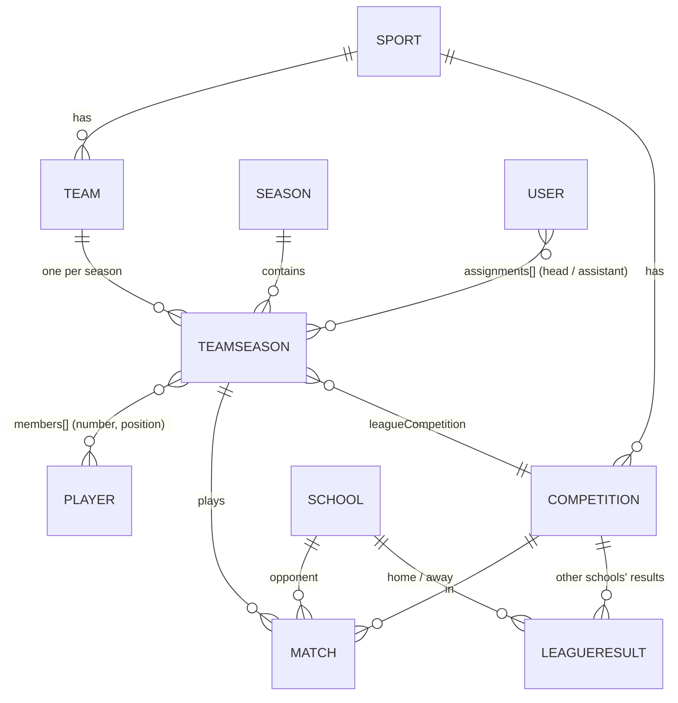

# 02 — Database Design

**Status:** Approved 2026-10-14 · **Phase:** 2 · **Builds on:** [00](00-design-inventory.md), [01](01-architecture.md)

MongoDB with Mongoose. Field types are Mongoose types. All dates are stored in UTC. "Req" means required.

## Summary

- **11 collections:** `sports`, `seasons`, `schools`, `competitions`, `teams`, `teamseasons`, `players`, `users`, `matches`, `leagueresults`, `halloffame`.
- **One schema for every sport.** A `Sport` document lists its positions, stat definitions, formations and leaderboards. Match and player stats are `key → number` maps that services validate against it. I agree with your preference (§3).
- **The season owns the squad.** Shirt number, position and captain live on `teamseasons`, not on the player.
- **Coach assignments live on the user** (§4). The public "Head Coach" card reads the same user record.
- **A match is one document**: fixture, score, events, lineup, team stats, player stats, top performers, report and photos. The page reads it in one query and result entry saves it in one atomic write.
- **Nothing derived is stored.** Standings, leaderboards, KPIs and roster analytics are aggregation pipelines. The data is small, so there's no cache to keep correct.



---

## 1. Shared conventions

| Convention | Rule |
|---|---|
| Audit (all collections) | `createdAt`, `updatedAt` (Mongoose timestamps), `createdBy`, `updatedBy` (ObjectId → `users`). Set by the audit plugin from the actor the service passes in. The seed sets them to the admin |
| Versioning | `__v` with `optimisticConcurrency: true` on `sports`, `teamseasons`, `matches`. Saves send the version they started from; a stale one returns 409 |
| Slugs | Lowercase, `a-z0-9-`, used in URLs. Unique where listed |
| Stat maps | `Map` of `Number` (Mongoose casts and rejects non-numbers). Keys must exist in the sport's definitions (service check) |
| Deletes | Hard delete only when nothing references the document (service check → 409). Users are disabled, never deleted |
| Images | Stored as URL strings (`/uploads/…`). Files live on disk (01 §6) |

---

## 2. Collections

### 2.1 `sports`

The definition each sport's data is validated against, plus its overview page content (D3, D4).

| Field | Type | Req | Default | Index / notes |
|---|---|---|---|---|
| `slug` | String | ✓ | — | unique · `football` |
| `name` | String | ✓ | — | `Football` |
| `icon` | String | ✓ | — | Material Symbol name |
| `order` | Number | ✓ | 0 | sidebar order |
| `status` | String enum `active` \| `comingSoon` | ✓ | `comingSoon` | Q8 |
| `periods` | `{ count: Number, minutes: Number }` | if active | — | 2×45 · 4×10 · 4×15 |
| `scoreDetail` | String enum `events` \| `periods` | if active | — | football: goal events · basketball/netball: score per quarter (Decision 6) |
| `scoringStat` | String | if active | — | player stat key that makes the score: `goals` / `points` |
| `standingsPoints` | `{ win, draw, loss: Number }` | if active | `{3,1,0}` | Q11 |
| `positions[]` | `{ key, name, headlineStats: [String] }` | — | `[]` | `FW` / Forward / `['goals','shots']`. Headline stats feed the Top Performer cards (Q13) |
| `formations[]` | `{ key, name, slots: [{ key, position, x, y }] }` | — | `[]` | `x`, `y` are % on the pitch. Number of starters = number of slots |
| `teamStats[]` | stat definition | — | `[]` | Match Stats tab, both sides |
| `playerStats[]` | stat definition | — | `[]` | Player Stats tab, leaderboards |
| `leaderboards[]` | `{ key, label, icon, group: attack\|defense\|discipline, stats: [String] }` | — | `[]` | Value = sum of the listed stats |
| `kpis` | `{ cleanSheets: Boolean, teamStat: String \| null }` | — | `{ false, null }` | Season KPI cards: win rate and total scored always; clean sheets and one averaged team stat (possession) when set |
| `content` | object (below) | — | `{}` | D4 overview page |

**Stat definition** (embedded, in both `teamStats` and `playerStats`):

| Field | Type | Req | Notes |
|---|---|---|---|
| `key` | String | ✓ | camelCase, unique within the list, **immutable once used** |
| `label` / `abbr` | String | ✓ | `Shots on target` / `SOT` |
| `icon` | String | — | team stats only |
| `type` | enum `count` \| `percent` \| `minutes` \| `ratio` | ✓ | `percent` is 0–100. `ratio` is computed, never stored |
| `ratio` | `{ numerator, denominator }` | if `ratio` | Shooting % = goals / attempts |
| `source` | enum `manual` \| `events` | ✓ | `events`: the service fills it from match events on save (goals, assists, cards) |
| `aggregation` | enum `sum` \| `avg` | ✓ | how a season total is built. Ratios aggregate as Σnumerator / Σdenominator |

**`content`** (D4): `hero { eyebrow, title, text, imageUrl }` · `history { text, imageUrl }` · `facts[] { icon, label, text }` · `approach { strategic, character }` · `benefits[] { icon, title, text }` · `videos[] { title, duration, category, url, thumbnailUrl }` · `pathways[] { title, text, url }`.

Example (football, arrays shortened):

```json
{
  "_id": "6650a1f0c0a8e1a1b2c3d401",
  "slug": "football", "name": "Football", "icon": "sports_soccer", "order": 1, "status": "active",
  "periods": { "count": 2, "minutes": 45 }, "scoreDetail": "events", "scoringStat": "goals",
  "standingsPoints": { "win": 3, "draw": 1, "loss": 0 },
  "positions": [
    { "key": "GK", "name": "Goalkeeper", "headlineStats": ["saves", "goalsConceded"] },
    { "key": "FW", "name": "Forward", "headlineStats": ["goals", "shots"] }
  ],
  "formations": [
    { "key": "4-3-3", "name": "4-3-3 Attacking", "slots": [
      { "key": "GK", "position": "GK", "x": 50, "y": 8 },
      { "key": "ST", "position": "FW", "x": 50, "y": 80 }
    ] }
  ],
  "teamStats": [
    { "key": "possession", "label": "Possession", "abbr": "Poss", "icon": "sports_soccer", "type": "percent", "source": "manual", "aggregation": "avg" },
    { "key": "yellowCards", "label": "Yellow Cards", "abbr": "YC", "icon": "style", "type": "count", "source": "events", "aggregation": "sum" }
  ],
  "playerStats": [
    { "key": "minutes", "label": "Minutes", "abbr": "Min", "type": "minutes", "source": "manual", "aggregation": "sum" },
    { "key": "goals", "label": "Goals", "abbr": "G", "type": "count", "source": "events", "aggregation": "sum" },
    { "key": "tackles", "label": "Tackles", "abbr": "Tkl", "type": "count", "source": "manual", "aggregation": "sum" }
  ],
  "leaderboards": [
    { "key": "scorers", "label": "Top Scorers", "icon": "sports_soccer", "group": "attack", "stats": ["goals"] },
    { "key": "defense", "label": "Defensive Pillars", "icon": "shield", "group": "defense", "stats": ["tackles", "clearances", "saves"] },
    { "key": "yellow", "label": "Yellow Cards", "icon": "warning", "group": "discipline", "stats": ["yellowCards"] }
  ],
  "kpis": { "cleanSheets": true, "teamStat": "possession" },
  "content": { "hero": { "eyebrow": "High Altitude Advantage", "title": "Football IQ", "text": "At 8,200ft…", "imageUrl": null } },
  "createdAt": "2026-08-20T07:00:00.000Z", "updatedAt": "2026-08-20T07:00:00.000Z",
  "createdBy": "6650a1f0c0a8e1a1b2c3d4a1", "updatedBy": "6650a1f0c0a8e1a1b2c3d4a1", "__v": 0
}
```

Stats per sport (agreed in Decision 6). `E` = filled from events; `%` = percent; `R` = ratio.

| Sport | Player stats | Team stats | Leaderboards (group) |
|---|---|---|---|
| Football | minutes, goals E, assists E, shots, shotsOnTarget, tackles, clearances, saves, goalsConceded, yellowCards E, redCards E | possession %, shots, shotsOnTarget, corners, fouls, yellowCards E, redCards E, offsides, saves | Top Scorers, Playmakers (attack) · Defensive Pillars = tackles + clearances + saves (defense) · Yellow, Red (discipline) |
| Basketball | minutes, points, rebounds, assists, steals, blocks, turnovers, fouls, threePointersMade, freeThrowsMade, freeThrowsAttempted, freeThrowPct R | rebounds, turnovers, fouls, steals, threePointers, layups, freeThrowPct %, assists | Top Scorers (points), Playmakers (assists) · Defensive Pillars = rebounds + steals + blocks · Fouls |
| Netball | goals, attempts, shootingPct R, intercepts, deflections, rebounds, turnovers, penalties | shootingPct %, centrePassConversion %, rebounds, turnoversWon, shots, contactPenalties, obstructionPenalties | Top Scorers (goals) · Defensive Pillars = intercepts + deflections + rebounds · Penalties |

Rugby, hockey and cricket are seeded as `comingSoon` with only `slug`, `name`, `icon`, `order`.

### 2.2 `seasons`

| Field | Type | Req | Default | Index / notes |
|---|---|---|---|---|
| `slug` | String | ✓ | — | unique · `2026-2027` |
| `label` | String | ✓ | — | `2026/2027` |
| `startDate`, `endDate` | Date | ✓ | — | `{ startDate: -1 }`. "Previous season" = the latest `startDate` before this one |
| `isCurrent` | Boolean | ✓ | `false` | unique partial index on `{ isCurrent: 1 }` where `true`: exactly one current season |

```json
{ "_id": "…d410", "slug": "2026-2027", "label": "2026/2027", "startDate": "2026-08-31T21:00:00.000Z", "endDate": "2027-07-31T20:59:59.000Z", "isCurrent": true }
```

### 2.3 `schools`

Turi and every opponent (Q29: Turi is edited here too).

| Field | Type | Req | Default | Index / notes |
|---|---|---|---|---|
| `name` | String | ✓ | — | unique · `Peponi School` |
| `shortName` | String | ✓ | — | `Peponi` (league table, overview) |
| `crestUrl` | String | — | `null` | initials badge when empty |
| `isHome` | Boolean | ✓ | `false` | unique partial index where `true`: Turi |

```json
{ "_id": "…d420", "name": "St. Andrew's Turi", "shortName": "St. Andrew's Turi", "crestUrl": "/uploads/seed/turi-crest.png", "isHome": true }
```

### 2.4 `competitions`

One per sport and division. Not per season: matches carry the season.

| Field | Type | Req | Default | Index / notes |
|---|---|---|---|---|
| `sport` | ObjectId → sports | ✓ | — | unique `{ sport: 1, name: 1 }` |
| `name` | String | ✓ | — | `KISL Premier Division` |
| `shortName` | String | ✓ | — | `KAISSO` (schedule column) |
| `type` | enum `league` \| `cup` \| `friendly` | ✓ | `league` | only `league` has a table |

```json
{ "_id": "…d430", "sport": "…d401", "name": "Kenya International Schools League · Premier Division", "shortName": "KISL", "type": "league" }
```

### 2.5 `teams`

A squad identity that lasts across seasons.

| Field | Type | Req | Default | Index / notes |
|---|---|---|---|---|
| `sport` | ObjectId → sports | ✓ | — | unique `{ sport: 1, slug: 1 }` · `{ sport: 1, order: 1 }` |
| `slug` | String | ✓ | — | `first-xi` |
| `name` | String | ✓ | — | free text (Q15): `First XI`, `Girls First V`, `U15 VII` |
| `ageGroup` | String | ✓ | `Open` | `Open`, `U19`, `U16`, `U15` |
| `gender` | enum `boys` \| `girls` \| `mixed` | ✓ | — | Q14 |
| `order` | Number | ✓ | 0 | roster tabs, default team = lowest |

```json
{ "_id": "…d440", "sport": "…d401", "slug": "first-xi", "name": "First XI", "ageGroup": "Open", "gender": "boys", "order": 1 }
```

### 2.6 `teamseasons`

A team in one season: its squad, captain, depth chart, league and season quote (D6, D12).

| Field | Type | Req | Default | Index / notes |
|---|---|---|---|---|
| `team` | ObjectId → teams | ✓ | — | unique `{ team: 1, season: 1 }` |
| `season` | ObjectId → seasons | ✓ | — | |
| `sport` | ObjectId → sports | ✓ | — | copied from the team (never changes) · `{ sport: 1, season: 1 }` |
| `members[]` | `{ player: ObjectId → players, number: Number, position: String }` | — | `[]` | multikey `{ 'members.player': 1 }`. Number unique within the squad; position ∈ sport positions (service checks) |
| `captain` | ObjectId → players | — | `null` | must be a member |
| `depthChart[]` | `{ position: String, players: [ObjectId] }` | — | `[]` | ordered: starter, 1st sub, … (Q12) |
| `leagueCompetition` | ObjectId → competitions | — | `null` | which league table this team appears in |
| `seasonQuote` | `{ text, attribution }` | — | `null` | Season Stats quote |

```json
{
  "_id": "…d450", "team": "…d440", "season": "…d410", "sport": "…d401",
  "members": [
    { "player": "…d460", "number": 9, "position": "FW" },
    { "player": "…d461", "number": 5, "position": "DF" }
  ],
  "captain": "…d461",
  "depthChart": [],
  "leagueCompetition": "…d430",
  "seasonQuote": { "text": "Discipline, teamwork, and an unwavering commitment…", "attribution": "Director of Athletics" },
  "__v": 3
}
```

### 2.7 `players`

The person. Nothing season-specific lives here.

| Field | Type | Req | Default | Index / notes |
|---|---|---|---|---|
| `firstName`, `lastName` | String | ✓ | — | `{ lastName: 1, firstName: 1 }` for dashboard search. Short form "O. Kariuki" is derived |
| `gender` | enum `female` \| `male` | ✓ | — | gender split, "Girl Players" |
| `photoUrl` | String | — | `null` | initials avatar when empty |

```json
{ "_id": "…d460", "firstName": "Otieno", "lastName": "Kariuki", "gender": "male", "photoUrl": null }
```

### 2.8 `users`

| Field | Type | Req | Default | Index / notes |
|---|---|---|---|---|
| `email` | String (lowercase, trimmed) | ✓ | — | unique |
| `name` | String | ✓ | — | `John Smith` |
| `title` | String | — | `null` | `Mr.`, `Ms.`, `Coach` → public "Mr. John Smith" |
| `photoUrl` | String | — | `null` | |
| `role` | enum `admin` \| `coach` | ✓ | `coach` | |
| `active` | Boolean | ✓ | `true` | disabled users can't sign in; they still show on past rosters |
| `passwordHash` | String | ✓ | — | `select: false`, never in any response |
| `mustChangePassword` | Boolean | ✓ | `true` | Q4 |
| `tokenVersion` | Number | ✓ | 0 | bump to revoke sessions |
| `assignments[]` | `{ teamSeason: ObjectId → teamseasons, role: 'head' \| 'assistant' }` | — | `[]` | multikey `{ 'assignments.teamSeason': 1 }` |

```json
{
  "_id": "…d4a2", "email": "j.smith@turi.test", "name": "John Smith", "title": "Mr.", "photoUrl": null,
  "role": "coach", "active": true, "passwordHash": "scrypt$131072$8$1$…", "mustChangePassword": false, "tokenVersion": 0,
  "assignments": [ { "teamSeason": "…d450", "role": "head" } ]
}
```

### 2.9 `matches`

Turi's fixtures and results (D13, D14). Turi's side is always `teamSeason`; the other side is `opponent`.

| Field | Type | Req | Default | Index / notes |
|---|---|---|---|---|
| `teamSeason` | ObjectId → teamseasons | ✓ | — | `{ teamSeason: 1, kickoffAt: 1 }` |
| `sport`, `season` | ObjectId | ✓ | — | copied from `teamSeason` · `{ sport: 1, season: 1, kickoffAt: 1 }` |
| `competition` | ObjectId → competitions | ✓ | — | `{ competition: 1, season: 1, kickoffAt: 1 }` |
| `round` | String | — | `null` | `Regional Final` |
| `opponent` | ObjectId → schools | ✓ | — | not the home school |
| `homeAway` | enum `home` \| `away` | ✓ | `home` | |
| `kickoffAt` | Date | ✓ | — | shown in EAT |
| `venue` | String | — | `null` | free text: `Turi Main Pitch` |
| `status` | enum `upcoming` \| `live` \| `completed` | ✓ | `upcoming` | |
| `score` | `{ turi: Number, opponent: Number }` | if live/completed | `null` | public before publishing (Q6) |
| `periodScores[]` | `{ turi, opponent }` | — | `[]` | `scoreDetail: periods` sports |
| `events[]` | `{ type: goal\|yellow\|red\|sub, side: turi\|opponent, minute, player, assist, playerOff, playerName, ownGoal }` | — | `[]` | `side` = the team the event counts for. `player` / `assist` / `playerOff` → players (Turi). `playerName` is free text for opponents. `ownGoal: true` = scored by the other side's player, so no player gets the goal stat |
| `formation` | String | — | `null` | key in sport `formations` |
| `lineup[]` | `{ player, number, slot }` | — | `[]` | `slot` set = starter, `null` = bench. `number` is a snapshot of the shirt worn |
| `teamStats` | `{ turi: Map<Number>, opponent: Map<Number> }` | — | `{}` | validated against `sport.teamStats` |
| `playerStats[]` | `{ player, position, stats: Map<Number> }` | — | `[]` | one row = the player appeared (counts for "P"). Validated against `sport.playerStats` |
| `topPerformers` | [ObjectId → players] | — | `[]` | max 3, first one gets the ★ (Q13) |
| `report` | `{ text, attribution }` | — | `null` | |
| `heroPhotoUrl` | String | — | `null` | scoreboard background |
| `galleryUrls` | [String] | — | `[]` | max 6 · Roster "Recent Match Gallery" |
| `publishedAt` | Date | — | `null` | `null` = draft. Public reads hide everything from `periodScores` down |

```json
{
  "_id": "…d470", "teamSeason": "…d450", "sport": "…d401", "season": "…d410",
  "competition": "…d431", "round": "Regional Final", "opponent": "…d421", "homeAway": "home",
  "kickoffAt": "2026-10-10T12:00:00.000Z", "venue": "Turi Main Pitch",
  "status": "completed", "score": { "turi": 3, "opponent": 1 }, "periodScores": [],
  "events": [
    { "type": "goal", "side": "turi", "minute": 14, "player": "…d460", "assist": "…d462" },
    { "type": "goal", "side": "opponent", "minute": 81, "playerName": "D. Patel" },
    { "type": "sub", "side": "turi", "minute": 65, "player": "…d468", "playerOff": "…d463" },
    { "type": "yellow", "side": "turi", "minute": 52, "player": "…d461" }
  ],
  "formation": "4-3-3",
  "lineup": [ { "player": "…d460", "number": 9, "slot": "ST" }, { "player": "…d468", "number": 12, "slot": null } ],
  "teamStats": { "turi": { "possession": 55, "shots": 14, "yellowCards": 1 }, "opponent": { "possession": 45, "shots": 8, "yellowCards": 3 } },
  "playerStats": [ { "player": "…d460", "position": "FW", "stats": { "minutes": 90, "goals": 2, "assists": 0, "shots": 5, "shotsOnTarget": 3 } } ],
  "topPerformers": ["…d460", "…d462", "…d461"],
  "report": { "text": "A resolute display of discipline and tactical superiority.", "attribution": "Director of Sport" },
  "heroPhotoUrl": null, "galleryUrls": [],
  "publishedAt": "2026-10-10T16:20:00.000Z", "__v": 7
}
```

**Validation in the service** (beyond types):

| When | Rule |
|---|---|
| Every save | Lineup and stat players are members of the team-season. Starters = formation slots, no slot used twice. Stat keys exist and are `manual` (event-sourced and ratio keys are rejected from input). Minutes ≤ match length + 40. Coaches can't move a match to another team they don't own |
| Every save | Event-sourced stats (goals, assists, cards) are recalculated from `events` and written into `playerStats` and the Turi side of `teamStats`, in the same write |
| Publish | `status = completed`. Turi score = Σ `scoringStat` over `playerStats` + own goals credited to Turi. `periodScores` sum to the score. At most 3 top performers, all of whom played |

### 2.10 `leagueresults`

Score-only results between two other schools (Decision 4, D15). Admin only, public at once.

| Field | Type | Req | Default | Index / notes |
|---|---|---|---|---|
| `competition` | ObjectId → competitions | ✓ | — | `{ competition: 1, season: 1, playedAt: 1 }` |
| `season` | ObjectId → seasons | ✓ | — | |
| `playedAt` | Date | ✓ | — | form guide order |
| `home`, `away` | `{ school: ObjectId → schools, score: Number }` | ✓ | — | neither is the home school; home ≠ away |

```json
{ "_id": "…d480", "competition": "…d430", "season": "…d410", "playedAt": "2026-09-20T12:00:00.000Z",
  "home": { "school": "…d421", "score": 2 }, "away": { "school": "…d422", "score": 2 } }
```

### 2.11 `halloffame`

Inductee cards (Q17). The layout gets a wireframe before it's built.

| Field | Type | Req | Default | Index / notes |
|---|---|---|---|---|
| `name` | String | ✓ | — | |
| `photoUrl` | String | — | `null` | |
| `sport` | ObjectId → sports | — | `null` | `{ sport: 1, order: 1 }` |
| `years` | String | — | `null` | `2015–2019` |
| `achievement` | String | ✓ | — | headline |
| `citation` | String | — | `null` | longer text |
| `player` | ObjectId → players | — | `null` | link when the inductee is in the system |
| `order` | Number | ✓ | 0 | |

---

## 3. Sports with different stats

**Agree with your preference**: one `Sport` definition, key→value maps validated against it. Why it's better than a schema per sport:

| Need | How the design handles it |
|---|---|
| Different stats per sport | `teamStats` / `playerStats` definitions. Match maps are checked against them on save |
| Different positions and lineups | `positions` and `formations` (with pitch coordinates) per sport |
| Goals with minutes vs score by quarter | `scoreDetail: events \| periods` |
| Stats a coach shouldn't type twice | `source: events` stats are calculated from events on save |
| Ratios (shooting %, FT%) | `type: ratio`, computed at read time from sums. Never averaging percentages |
| Different leaderboards and points | `leaderboards`, `standingsPoints`, `kpis` |
| One generic UI | Result entry, tables and leaderboards render from the definition, so adding hockey is data, not code |

Guard rails: stat keys can't be renamed once used. Removing a definition hides its values but keeps them.

## 4. Relationships: embed or reference

| Relationship | Choice | Why (the queries that decide it) |
|---|---|---|
| Sport → positions, stat defs, formations, leaderboards, content | **Embed** | Always read with the sport (result entry, every stats page). Small, edited together in D3/D4 |
| Team → Sport, TeamSeason → Team/Season, Match → TeamSeason/Competition/Opponent | **Reference** | Shared, reused across many documents, small to populate |
| Squad members (number, position) | **Embed in `teamseasons`** | The roster page and lineup picker read the whole squad in one go (≤ 40 players). Numbers and positions belong to the season |
| Member → Player | **Reference** | A player spans teams and seasons; name and photo are edited once |
| Coach assignments | **Embed in `users`** | (1) Read on every staff request to check permissions, at no extra cost because `authenticate` already loads the user. (2) Users are admin-only, so a coach can never assign themselves. (3) Edited where the admin manages the coach (D9/D10). (4) The public roster finds its coaches with one indexed query on `assignments.teamSeason` and projects only name, title and photo. Rejected: `teamseasons.staff` (coaches can write team-seasons, so field-level rules would be needed) and a separate collection (an extra join everywhere, with no extra fields to justify it) |
| Match → events, lineup, stats, report, photos | **Embed** | The match page needs all of it in one read. Result entry saves it as one atomic write. Bounded (< 50 KB) |
| League results | **Own collection** | Different shape (two other schools, score only). Merged into the standings pipeline with `$unionWith` |

Copied fields, all safe because they never change after creation: `matches.sport`, `matches.season`, `teamseasons.sport` (avoid joins on the most common filters); `lineup.number` (historical truth); event-sourced stats (written in the same save as the events).

## 5. Draft vs published, audit

- `matches.publishedAt = null` is a draft. **Public responses** of a draft contain the fixture fields, `status` and `score` (Q6, so the live banner works) and nothing else.
- Standings, leaderboards, KPIs and records count only `status: completed` **and** `publishedAt ≠ null`.
- Admins and the match's assigned coaches see the full draft (policy `readDraft`).
- Every collection has `createdBy` / `updatedBy` / timestamps (§1).

## 6. Derived data

Computed with aggregation pipelines in the owning service. **Nothing is cached**, so a coach's edit shows up on the next request. Scale is tiny: about 15 team-seasons × 20 matches a season. The largest pipeline (a leaderboard) unwinds about 500 player rows.

| Data | Pipeline (on published, completed matches) | Index |
|---|---|---|
| League table | `matches {competition, season}` → two rows per match (Turi, opponent) · `$unionWith leagueresults` → two rows each · group by school: P W D L GF GA GD · points from `sport.standingsPoints` · last 5 results by date → form | `matches {competition, season, kickoffAt}` · `leagueresults {competition, season, playedAt}` |
| Season KPIs | `matches {teamSeason}` → win rate, Σ Turi score, clean sheets, avg of the `kpis.teamStat` · same for the previous season's team-season → change | `matches {teamSeason, kickoffAt}` |
| Team form chart | last 10 by `kickoffAt` → `kpis.teamStat` + goal difference per match | same |
| Leaderboards | `$unwind playerStats` → group by player: appearances (P) and Σ of the leaderboard's stats → sort → top 3 / top 10 | same |
| Records | max Turi score (Scoring Peak), max margin (Dominant Win), max opponent score (Defensive Struggle) (Q25) | same |
| Overview top scorers | as Leaderboards, but over every team of the sport in the current season | `matches {sport, season, kickoffAt}` |
| Roster analytics | members of this team-season ⋈ players → count, gender split · previous season's same-sport squads → new vs returning · all team-seasons of the sport this season → academy distribution (Q28) | `teamseasons {sport, season}`, `{team, season}` |

---

## 7. Query table

`→` = query, then the index that serves it. Tiny collections (`sports`, `seasons`, `schools`, `users`, under 100 docs) use their unique indexes or a scan.

### Public pages

| Page | Queries → index |
|---|---|
| Every page (shell) | sports by `order` → scan (≤ 10) · home school → `schools {isHome}` · current season → `seasons {isCurrent}` |
| Overview | sport → `sports {slug}` · next 4 fixtures (`status: upcoming`) → `matches {sport, season, kickoffAt}` · top scorers → same · standings of the first team's league → see League Table |
| Schedule | team-seasons of sport+season → `teamseasons {sport, season}` · fixtures with month range and view → `matches {sport, season, kickoffAt}`, or `{teamSeason, kickoffAt}` when filtered by team · live banner (`status: live`) → `matches {sport, season, kickoffAt}` · opponents → `schools _id` |
| Match page | match → `_id` · team-season, competition, opponent → `_id` · players → `_id $in` · coaches → `users {assignments.teamSeason}` |
| Roster | team → `teams {sport, slug}` · season → `seasons {slug}` · squad → `teamseasons {team, season}` · players → `_id $in` · coaches → `users {assignments.teamSeason}` · analytics → `teamseasons {sport, season}` · gallery (last 3 published with photos) → `matches {teamSeason, kickoffAt}` |
| Season Stats | squad → `teamseasons {team, season}` · KPIs, form, leaderboards, records → `matches {teamSeason, kickoffAt}` · previous season → `seasons {startDate}` + `teamseasons {team, season}` |
| League Table | `teamseasons {team, season}` → `leagueCompetition` · standings → `matches {competition, season, kickoffAt}` + `leagueresults {competition, season, playedAt}` · schools → `_id $in` |
| Hall of Fame | entries → `halloffame {sport, order}` |

### Dashboard

| Screen | Queries → index |
|---|---|
| Login | user by email → `users {email}` |
| Every request | user (and assignments) → `_id` |
| D2 Home | fixtures waiting for a result and drafts for my team-seasons → `matches {teamSeason, kickoffAt}` (admin: `{sport, season, kickoffAt}`) |
| D3 / D4 Sports | list → scan · one → `sports {slug}` |
| D5 Seasons | list → `seasons {startDate}` |
| D6 Teams | per sport → `teams {sport, order}` · season quote → `teamseasons {team, season}` |
| D7 Competitions | per sport → `competitions {sport, name}` |
| D8 Schools | list → `schools {name}` |
| D9 / D10 Users | list → scan · team-season picker → `teamseasons {sport, season}` |
| D11 Players | coach: own squads → `teamseasons _id $in` → players `_id $in` · admin search → `players {lastName, firstName}` |
| D12 Roster | `teamseasons {team, season}` · add player search → `players {lastName, firstName}` |
| D13 Fixtures | `matches {teamSeason, kickoffAt}` (admin across a sport: `{sport, season, kickoffAt}`) |
| D14 Match result | match → `_id` · sport → `_id` · squad → `_id` |
| D15 Other league results | `leagueresults {competition, season, playedAt}` |
| D16 Hall of Fame | `halloffame {sport, order}` |
| D17 My account | user → `_id` |
| Policy check: coach edits a player | `teamseasons {_id ∈ my assignments, members.player}` → `_id` + `{members.player}` |

---

## 8. Seed plan

`npm run seed` (refuses to run when `NODE_ENV=production`). Deterministic: a fixed-seed random generator, so every run produces the same data. Two parts:

| Part | Contents | Production? |
|---|---|---|
| **Reference** | 6 sports (football, basketball and netball with full definitions and corrected overview copy; rugby, hockey and cricket `comingSoon`), the home school, the first admin | Yes (`npm run seed -- --reference`) |
| **Demo** | Everything below | Never |

| Data | Plan |
|---|---|
| Seasons | 2025/2026 (Sep–Jul, finished) and **2026/2027 (current)**. Mockup dates (Oct 2024) move to the current season so the site looks live today |
| Schools | St. Andrew's Turi (home) + the 5 league opponents from the mockup table (Peponi School, Brookhouse School, Braeburn School, Rift Valley Academy, Hillcrest International School) + Kenton College and Braeburn Garden Estate for cups and friendlies. Crests: initials badges until you send logos (Q21) |
| Competitions | One league per team division (e.g. *KISL Premier Division* for Football First XI, *KAISSO U16 League*), plus *IAPS Cup*, *Rift Valley Regionals* (cup) and *Friendlies* per sport |
| Teams (8) | Football: First XI (boys), Second XI (boys), U16 (mixed), U15 Girls · Basketball: Girls First V, Boys First V · Netball: First VII, U15 VII |
| Players (~160 distinct) | Fictional names (Decision 5). Squads: football 18, Girls First V 17 (**all 17 basketball portraits**), Boys First V 12, First VII 12 (**the 5 netball portraits**), U15 VII 10. About 70% return the next season, so "new vs returning" has real numbers. Initials avatars for everyone else |
| Users | 1 admin (Director of Sport) + 5 coaches: football head (First XI, Second XI), football assistant (First XI, U16, U15 Girls), basketball head (male coach portrait; both basketball teams), basketball assistant (female coach portrait; Girls First V), netball head (netball coach portrait; both netball teams). Plus 1 disabled former coach |
| Matches | Each team-season: a full double round-robin league (10 matches against the 5 opponents) + 2–3 cup or friendly games. 2025/26 all completed and published. 2026/27 as of today: ~5 completed and published, 1 completed **draft**, 1 **live** (Football First XI), ~5 upcoming through November |
| Match detail | Scores in a realistic range for the sport (football 0–4, basketball 35–80, netball 25–55). Lineups from the squad and a formation. Events add up to the score. Player stats agree with the score (Σ goals or points = Turi score, shots ≥ on target ≥ goals). Top performers = best headline stats. A few report quotes |
| League results | The other 20 games of each 6-team double round-robin (only the ones played so far in 2026/27). Every league table shows P = 10 by season's end, like the mockup |
| Hall of Fame | 6 fictional inductees |
| Images | The 22 player and 3 coach portraits, **resized once to 400px JPEG** and committed under `server/scripts/seed-assets/`. The seed copies them into `UPLOAD_DIR/seed/`. The 1.4 MB originals are never served |
| Credentials | Emails `firstname.lastname@turi.test` (`.test` is a reserved domain). Passwords come from `SEED_ADMIN_EMAIL`, `SEED_ADMIN_PASSWORD`, `SEED_COACH_PASSWORD` in `.env.example`, never from the docs. Seeded accounts skip the forced password change |

Not seeded: hero, history and gallery photos (placeholders until you send them, Q22).
